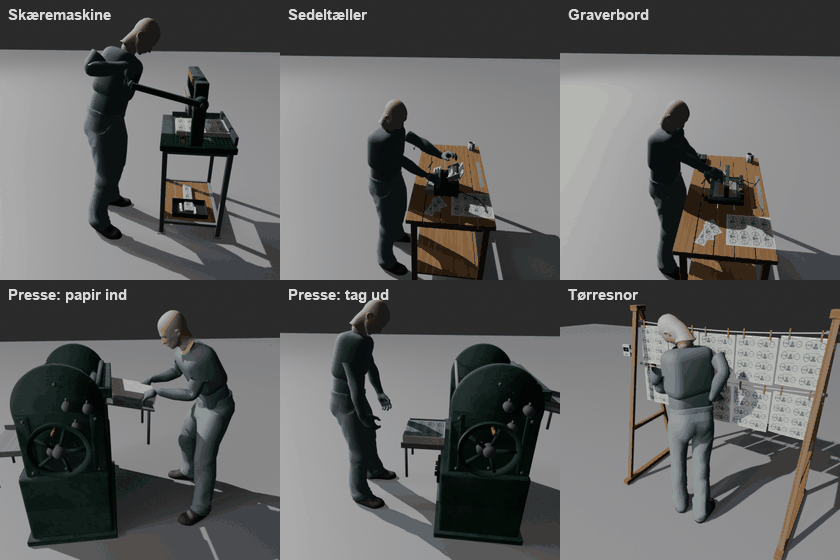

# mach1ne_counterfeit

Falskmøntneri til FiveM (ESX + st_libs + ox_inventory + oxmysql). Man trykker ark med falske 1000-sedler, hænger dem til tørre, skærer dem ud og tæller dem op i bundter. Bundterne kan sælges til en hæler. Alle maskiner er egne Blender-modeller med skelet og **prop-animationer**: valserne drejer, kniven skærer, arkene svajer og sedlerne bladres.




## Flow

```
Bomuldspapir (2) + Blæk (1) ──Trykpresse 6 min──► Våde trykark (2)      [larmer]
Våde trykark (2)            ──Tørresnor 8 min───► Trykark (2)
Trykark (1)                 ──Skæremaskine 5 s──► Løse sedler (8)       [aktiv]
Løse sedler (25) + Banderole ─Sedeltæller 4 s───► Bundt (serie LS xxxxxX) [aktiv]
Bundt ──Hæler──► 45 % af pålydende i sorte penge
```

- **Tidsstyrede maskiner** (presse, tørresnor): Fyld dem, gå fra dem og hent outputtet, når tiden er gået. Våde ark, der ligger for længe i pressen, klistrer sammen (`spoil`).
- **Aktive maskiner** (skæremaskine, sedeltæller): Man står ved maskinen, mens den arbejder, og outputtet kommer direkte i inventaret. Afbryder man, får man materialerne tilbage.
- **Støj**: Mens en presse kører, er der `Config.Noise.callChancePerMinute` % chance pr. minut for, at naboerne ringer. Politiet får så et område på kortet.
- **Serienumre**: Hver optælling får en serie, f.eks. `LS 04821K`. Serien står i bundtets metadata og bliver gemt i `m1_counterfeit_serials` sammen med sedeltællerens position.
- **UV-scanner** (`cf_scanner`): Alle kan se, at deres bundter er falske. Politiet ser også, hvornår og i hvilket område hver serie blev talt op, og kan sætte et omtrentligt waypoint.

## Byg dit værksted

Alt placeres fra inventaret som i `mach1ne_cocaine`: ude, inde, i housing-buckets og oven på andre objekter, f.eks. en sedeltæller på et arbejdsbord.

| Tast | Handling |
| --- | --- |
| `E` | Placér |
| `← →` | Rotér (`Shift` = fint) |
| `Scroll` | Hæv/sænk |
| `Backspace` / højreklik | Annullér |

| Objekt | `E` | `G` (ejer) | `H` (politi) |
| --- | --- | --- | --- |
| Trykpresse / tørresnor | Fyld / se tid / tøm | Pak sammen (tom) | Beslaglæg |
| Skæremaskine / sedeltæller | Arbejd ved maskinen | Pak sammen | Beslaglæg |
| Arbejdsbord | - | Pak sammen | Beslaglæg |

## Sprog

Alle tekster ligger i `locales/da.json` og `locales/en.json` (st_libs `locale()`). Sproget vælges med `Config.Locale`. Navne på maskiner og items samt tekster som `fillText` står stadig i `config.lua`.

## Krav

`es_extended`, `ox_lib`, `ox_inventory`, `oxmysql`, `st_libs`

## Installation

1. Læg mappen `mach1ne_counterfeit` i din `resources`-mappe.
2. Tabellerne oprettes automatisk (`sql/install.sql` findes også).
3. **ox_inventory**:
   - Indsæt blokken fra `install/ox_inventory/items.lua` i `ox_inventory/data/items.lua` (inden den sidste `}`).
   - Kopiér `install/ox_inventory/images/*.png` til `ox_inventory/web/images/`.
4. Tilføj til `server.cfg` efter afhængighederne:

```cfg
ensure mach1ne_counterfeit
```

Hæleren (`Config.Dealer`) står som standard på Elysian Island. Han sælger papir, blæk, banderoler og alle maskiner og køber bundter. Ret `coords`, hvis han står et dårligt sted. `cf_scanner` sælges ikke, så giv den til politiet via dit eget job-shop eller armory.

## Prop-animationer

Maskinerne er drawables med skelet, og hver bevægelig del hænger på sin egen knogle. Animationerne ligger i `stream/m1_cf_anims.ycd` og afspilles med `PlayEntityAnim` på klienten. Archetyperne i `mach1ne_counterfeit.ytyp` peger på clip-dictionaryen og har flaget *Has Anim (YCD)*.

| Clip | Model | Længde | Hvad sker der |
| --- | --- | --- | --- |
| `press_run` | `m1_cf_press_on` | 2 s loop | Valser, blækvalser, svinghjul og tandhjul drejer. Et ark kører ind bagfra, under valserne og ned i bakken |
| `dryline_sway` | `m1_cf_dryline_wet/dry` | 4 s loop | 10 ark svajer i vinden med hver sin fase |
| `cutter_cut` | `m1_cf_cutter_loaded` | 2,5 s loop | Pressebjælken spænder, armen trækkes ned, kniven skærer, og en strimmel sedler glider frem |
| `counter_count` | `m1_cf_counter_run` | 1 s loop | Valsen drejer, og fire sedler ad gangen vipper ned i maskinen og glider ud i lommen |

## Ped-animationer

Spilleren har egne animationer i `stream/m1_cf_ped.ycd`. De er lavet på freemode-skelettet og passer præcist til maskinerne:

| Clip | Maskine | Længde | Hvad spilleren gør |
| --- | --- | --- | --- |
| `cut` | Skæremaskine | 2,5 s loop | Begge hænder på håndtaget, trækker det ned i takt med kniven, bøjer i knæene og læner sig ind |
| `count` | Sedeltæller (på bord) | 2 s loop | Venstre hånd holder bunken i tragten, højre retter sedlerne til i lommen, blikket følger displayet |
| `press_feed` | Trykpresse (bagpå) | 2 s loop | Retter papirstakken til på indføringsbordet og skubber den frem |
| `press_take` | Trykpresse (foran) | 4 s | Bukker sig ned, griber bunken i bakken og løfter den op |
| `hang` | Tørresnor | 3 s loop | Rækker op, sætter arket i klemmerne og glatter det ud |

Spilleren går hen til `work.offset` / `take.offset` og bliver stillet præcist der med `TaskPlayAnimAdvanced`. På de aktive maskiner genstartes maskinens animation samtidig, så kniven går ned, præcis når spilleren trækker i håndtaget.

Animationerne er lavet til de offsets, der står i `config.lua`. Sedeltælleren er lavet til at stå på et bord i 0,9 m højde (`cf_table`). Ændrer du offsets eller bordhøjde, passer hænderne ikke længere til maskinerne.

Prop-animationerne spiller for alle i nærheden, fordi maskinens tilstand synkroniseres fra serveren. Når spilleren starter sin animation, sender klienten `animStart` til serveren. Serveren sender tidspunktet videre, og alle klienter sætter maskinens animation i samme fase med `SetEntityAnimCurrentTime`. De andre spillere ser altså kniven gå ned samtidig med armene. Spillere, der kommer til senere, får den forløbne tid med fra serveren.

Findes en custom model ikke, bruges en vanilla-fallback (`bkr_prop_*`) uden prop-animation.

## Ydelse

- **Fælles teksturer**: Alle modeller bruger samme texture dictionary, `stream/m1_cf_tex.ytd`, i stedet for at have teksturerne embedded hver for sig.
- **LOD**: Hver model har en forenklet medium-LOD med ca. 40 % af trekanterne. Høj LOD vises op til 15 m, medium op til 70 m, og derefter forsvinder modellen. Sedeltælleren bruger 14/35 m.
