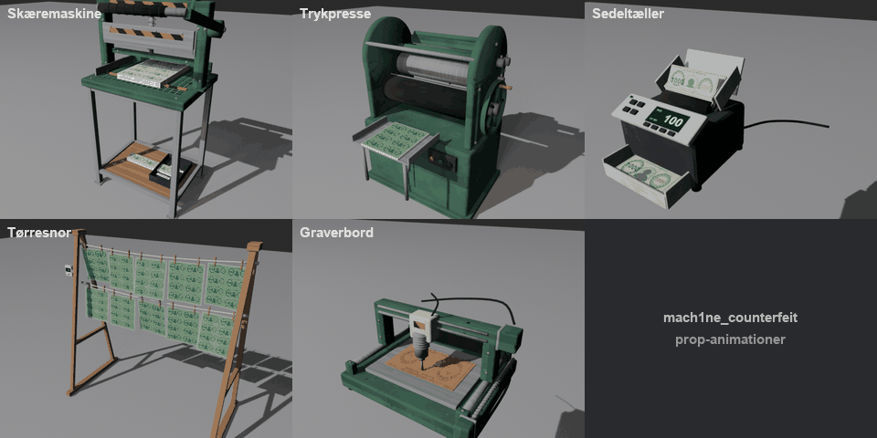

<div align="center">

# mach1ne_counterfeit

**Lav falske penge i FiveM.** Print sedlerne, tør dem, skær dem ud og pak dem i bundter. Du bygger selv dit værksted, hvor du vil.


 

</div>

---

## Indhold

- [Sådan laver du pengene](#sådan-laver-du-pengene)
- [Installation](#installation)
- [Andre scripts](#andre-scripts)
- [Trykplader](#trykplader)
- [Kurer-opgaver](#kurer-opgaver)
- [Trykpressen fra Union-heistet](#trykpressen-fra-union-heistet)
- [Adgang til maskinerne](#adgang-til-maskinerne)
- [Styring](#styring)
- [Skærmene](#skærmene)
- [Politiet](#politiet)
- [Indstillinger](#indstillinger)
- [Animationer](#animationer)

## Sådan laver du pengene

| Trin | Maskine | Du skal bruge | Du får | Tid |
| :-: | --- | --- | --- | --- |
| 0 | **Graverbord** | 1 kobberplade | 1 trykplade med dit eget prefiks | 20 sek |
| 1 | **Trykpresse** | 2 bomuldspapir + 1 blæk + en trykplade | 2 våde ark | 6 min |
| 2 | **Tørresnor** | 2 våde ark | 2 tørre ark | 8 min |
| 3 | **Skæremaskine** | 1 tørt ark | 8 sedler | 5 sek |
| 4 | **Sedeltæller** | 25 sedler + 1 papirbånd | 1 bundt | 4 sek |
| 5 | **Hæleren** | Bundter | Sorte penge (ca. 45 % af værdien, svinger) | |

Har du materialer nok, kan du lave flere ad gangen. Alle tal kan ændres i `config.lua`.

> **Trykpressen og tørresnoren** passer sig selv. Fyld dem, gå din vej, og kom tilbage, når de er færdige. Men glem ikke de våde ark i pressen for længe, for så klistrer halvdelen sammen.
>
> **Ved skæremaskinen og sedeltælleren** skal du blive stående, mens de arbejder. Går du, får du dine ting tilbage.

## Trykplader

Før du kan trykke, skal du have en trykplade. Den laver du på **graverbordet** (stil det på et bord) ud fra en kobberplade fra hæleren.

- Du vælger selv et **prefiks på 2 bogstaver**, fx `AB`. Det står foran serienummeret på alle dine sedler: `AB 04821K`.
- Et prefiks tilhører den, der lavede det første gang. Andre kan ikke bruge det.
- Pladen sættes **i pressen** (`Isæt trykplade`), og du kan se den sidde på valsen. Den bliver siddende, til den er slidt op eller du tager den ud.
- Pladen **slides**: den kan bruges til 20 portioner (`Config.Plate.uses`), og så er den væk.
- Hver presse har sit eget **serienummer** på typeskiltet, fx `KO-41877`.
- Pladens prefiks og pressens serienummer følger arkene og sedlerne hele vejen igennem til bundtet.

> [!WARNING]
> Pas på din plade. Får politiet fat i den (eller beslaglægger pressen med pladen i), kan de se, hvem der ejer den. Så viser deres scanner ejerens navn på **alle** bundter med dit prefiks.

## Kurer-opgaver

Hos hæleren kan du tage en **leveringsopgave**: kør et antal bundter ud til en køber på kortet inden for 15 minutter.

- Du får **25 % mere** end hæleren betaler ved disken.
- Der er en chance på 25 % for, at politiet får et anonymt tip om stedet.
- Kommer du for sent, er køberen gået. Du kan tage en ny opgave hvert 20. minut.
- Alt kan justeres under `Config.Courier`, også afleveringsstederne.

## Trykpressen fra Union-heistet

Trykpressen kan ikke købes. Den står inde i boksen i **Union Depository** og kan kun afmonteres, mens boksen er åben under heistet **[machine_unheist](https://github.com/TheMachineDK123/machine_unheist)**. Der er én presse pr. server-genstart, ligesom pengevognene i heistet.

Heistet har allerede de to exports (`isVaultOpen` og `isCrew`), som counterfeit bruger. Sæt `Config.Heist.resource` til navnet på heist-mappen (standard `mani-unheist`). Placeringen af pressen i boksen står i `Config.Heist.coords`.

## Installation

**Du skal have:** [es_extended](https://github.com/esx-framework/esx_core), [ox_lib](https://github.com/overextended/ox_lib), [ox_inventory](https://github.com/overextended/ox_inventory), [oxmysql](https://github.com/overextended/oxmysql) og st_libs.

1. Læg mappen `mach1ne_counterfeit` i din `resources`-mappe.
2. Tilføj tingene til ox_inventory:
   - Kopiér teksten fra [`install/ox_inventory/items.lua`](install/ox_inventory/items.lua) ind i `ox_inventory/data/items.lua`, lige før den sidste `}`.
   - Kopiér billederne fra [`install/ox_inventory/images/`](install/ox_inventory/images) over i `ox_inventory/web/images/`.
3. Skriv det her i din `server.cfg` (under de andre scripts, den bruger):

   ```cfg
   ensure mach1ne_counterfeit
   ```

4. Start serveren. Databasen sætter sig selv op første gang.

> [!NOTE]
> Hæleren står på Elysian Island. Du kan flytte ham i `config.lua` under `Config.Dealer`.
> Politiets udstyr (`cf_uvlight` UV-lommelygte, `cf_scanner` og `cf_uvscanner` til bordet) kan ikke købes hos hæleren. Giv det til politiet, f.eks. i deres våbenlager.
>
> Bruger du ox_target, skal den startes før `mach1ne_counterfeit`. Vil du hellere have 3D-tekst, så sæt `Config.Interaction = 'st_libs'`.

## Adgang til maskinerne

Dine maskiner kan kun bruges af dig og de spillere, du giver adgang. Andre kan ikke fylde, tømme eller starte dem. Politiet kan stadig beslaglægge dem.

Du giver adgang fra en **laptop** i værkstedet:

1. Åbn laptoppen og vælg **Adgang til maskiner**. Du ser kun de maskiner, du selv ejer, inden for laptoppens rækkevidde (`Config.Screens.types.laptop.range`).
2. Vælg **Tilføj bruger til alle mine maskiner her**, eller vælg én maskine og **Tilføj bruger**.
3. Skriv spillerens ID. Spilleren skal være online.
4. Klik på en bruger under en maskine for at fjerne adgangen igen.

Kun ejeren kan pakke en maskine sammen.

## Styring

**Når du stiller noget op**

| Tast | Hvad sker der |
| --- | --- |
| `E` | Stil det her |
| `←` `→` | Drej (hold `Shift` for at dreje langsomt) |
| `Scroll` | Op og ned |
| `Backspace` eller højreklik | Fortryd |

**Ved maskinerne**

Med ox_target sigter du bare på tingen og vælger i menuen. Med 3D-tekst bruger du tasterne herunder.

| | `E` | `G` (kun ejeren) | `H` (kun politi) |
| --- | --- | --- | --- |
| Trykpresse og tørresnor | Fyld, se tid eller tøm (`Y`: isæt eller tag pladen ud) | Pak sammen (skal være tom) | Beslaglæg (`L`: aflæs typeskilt) |
| Skæremaskine og sedeltæller | Gå i gang | Pak sammen | Beslaglæg |
| Arbejdsbord | | Pak sammen | Beslaglæg |
| Graverbord | Gravér en trykplade | Pak sammen | Beslaglæg |
| Laptop | Se dine maskiner og styr, hvem der må bruge dem | Pak sammen | Beslaglæg |
| UV-scanner (bord) | Scan bundter (kun politi) | Pak sammen | |
| Kursskærm | Se kursen | Pak sammen | Beslaglæg |

Står dit værksted inde i et hus, kan kun folk, der er inde i huset, se det.

## Skærmene

Flere af tingene har en skærm, der viser hvad der sker lige nu:

| Ting | Skærmen viser |
| --- | --- |
| **Sedeltæller** | Tæller sedlerne op, mens den kører, og viser bagefter serienummeret på bundtet |
| **Tørresnor** | En fugtmåler, der falder, mens arkene tørrer, og skriver *TØR*, når de er klar |
| **Laptop** | Alle maskiner i nærheden: om de er tomme, kører eller er færdige, og hvor lang tid der er tilbage |
| **UV-scanner (bord)** | Resultatet af politiets seneste scanning: *FALSK*, serienummer, område og dato |
| **Kursskærm** | Hvad hæleren betaler for et bundt lige nu, om prisen er på vej op eller ned, og hvor stor efterspørgslen er |

Står der flere af samme slags, er det den, du står tættest på, der er tændt.

**Hælerens pris** falder, når der bliver solgt mange bundter, og stiger langsomt igen, når der er roligt. Det kan du justere under `Config.Dealer.sell`.

**Kursskærmen** køber du hos hæleren og stiller op, hvor du vil, fx i dit værksted. Så kan du holde øje med prisen og sælge, når den er høj. Vil du også have en fast skærm ved hæleren, så sæt `Config.Dealer.board.enabled = true`.

## Politiet

- **Naboerne ringer:** mens pressen kører, kan politiet få et område vist på kortet. Det sker kun, når pressen står ude i verden, ikke inde i et hus (kan slås til med `Config.Noise.callFromInstances`).
- **UV-lommelygte:** tænd den og lys på en person (tryk `E`) for at se de falske bundter, personen har på sig, med serie, presse og eventuelt pladens ejer. Lys på en maskine for at aflæse typeskiltet.
- **Typeskilt:** ved en presse kan politiet aflæse serienummeret og se, hvilken plade der sidder i.
- **UV-scanner i lommen:** alle kan se, at sedlerne er falske. Politiet kan også se, hvornår bundtet blev lavet, og cirka hvor. De kan sætte et punkt på kortet.
- **UV-scanner på bordet:** politiet kan stille en scanner op på stationen. Resultatet kommer også op på scannerens skærm, så kollegaerne kan se med.
- **Beslaglæg:** tryk `H` ved en maskine for at tage den.

## Indstillinger

Alt kan ændres i [`config.lua`](config.lua):

| Indstilling | Hvad den gør |
| --- | --- |
| `Config.Locale` | Sproget: `da` eller `en`. Teksterne ligger i [`locales/`](locales) |
| `Config.Interaction` | `'ox_target'` eller `'st_libs'` (3D-tekst) |
| `Config.Screens` | Slå skærmene til og fra, og hvor tæt på man skal være |
| `Config.Stations` | Hvad maskinerne skal bruge, hvad de giver, og hvor lang tid det tager |
| `Config.Bundle` | Hvor mange sedler der er i et bundt, og hvad det er værd |
| `Config.Plate` | Hvor mange portioner en trykplade holder, og hvilke prefikser der ikke må bruges |
| `Config.Courier` | Kurer-opgaver: antal bundter, tid, bonus, chancen for tip og afleveringssteder |
| `Config.UVLight` | UV-lommelygtens rækkevidde og farve |
| `Config.Heist` | Trykpressen i Union-heistet: placering, og om kun heist-holdet må tage den |
| `Config.Noise` | Hvor tit naboerne ringer |
| `Config.Police` | Hvilke jobs der tæller som politi |
| `Config.Dealer` | Hvor hæleren står, hvad han sælger, hvordan prisen svinger, og om der skal stå en fast kursskærm ved ham |
| `Config.StationLimits` og `Config.Props` | Hvor mange maskiner hver spiller må have |

## Animationer

Maskinerne og din figur bevæger sig i takt. Når du trækker i håndtaget, går kniven ned, og det ser alle omkring dig.

<details>
<summary><b>Maskinerne</b></summary>

<br>

| Maskine | Hvad sker der |
| --- | --- |
| Trykpresse | Valserne og svinghjulet drejer, og et ark kører igennem og lander i bakken |
| Tørresnor | Sedlerne svajer i vinden |
| Skæremaskine | Armen går ned, kniven skærer, og en stribe sedler glider frem |
| Sedeltæller | Sedlerne bladres ned i maskinen og kommer ud foran |

</details>

<details>
<summary><b>Din figur</b></summary>

<br>

| Maskine | Hvad du gør |
| --- | --- |
| Skæremaskine | Tager fat med begge hænder og trækker håndtaget ned |
| Sedeltæller | Holder bunken og retter sedlerne til |
| Trykpresse, bagfra | Retter papiret til og skubber det ind |
| Trykpresse, forfra | Bukker dig ned og løfter bunken op |
| Tørresnor | Rækker op og hænger arket op |
| Graverbord | Styrer gravérhovedet hen over pladen og holder fast i maskinen |

</details>

> [!IMPORTANT]
> Animationerne passer til de pladser, der står i `config.lua`. Sedeltælleren skal stå på arbejdsbordet. Flytter du på pladserne, rammer hænderne ved siden af.

---

<div align="center">

Lavet af **TheMach1neDK**

</div>

## Andre scripts

- **[machine_unheist](https://github.com/TheMachineDK123/machine_unheist)**: Union Depository-heistet, hvor trykpressen står.
- **[mach1ne_counterfeit](https://github.com/TheMachineDK123/mach1ne_counterfeit)**: dette script.
